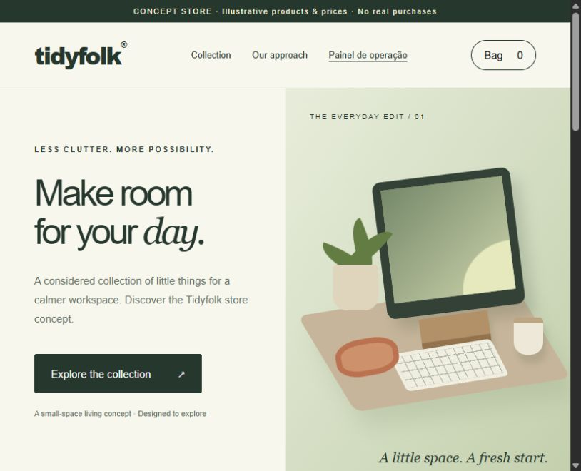

# Tidyfolk — Storefront & Operations Prototype

A responsive, dependency-free e-commerce concept for a calmer workspace. Explore a product catalog, build a shopping bag, simulate an order, and inspect the result in a small operations dashboard.

**Portfolio project · HTML · CSS · JavaScript · Browser-local state**



> This is a demonstration, not a functioning retail business. Products, prices and illustrations are examples. No payments are processed, no orders are sent to suppliers, and no customer details are collected.

## Try it locally

Clone this repository and open `dist/index.html` in a modern browser. No installation or build step is required. For consistent browser storage behavior, use the included local server with Node.js 18 or later:

```sh
git clone https://github.com/santdevfull/tidyfolk-storefront.git
cd tidyfolk-storefront
npm start
```

Open **http://127.0.0.1:4173**. There are no npm dependencies to install.

The original [hosted demonstration](https://tidyfolk-desk-concept.santdev-contato.chatgpt.site) is owner-private and requires the owner's ChatGPT account. Recruiters can use the screenshot and run this public source locally; the hosted link is not a public portfolio preview.

## Features

| Area | Implemented behavior |
| --- | --- |
| Storefront | Responsive layout, category filters, product details and original SVG/CSS illustrations |
| Shopping bag | Quantity changes, removal, subtotal calculation and empty state |
| Order simulation | Browser-local order record, bag reset and explicit no-payment confirmation |
| Operations dashboard | Simulated order count, subtotal, order history and JSON export |
| Unit economics | Editable price, product cost, shipping, fees, return reserve and acquisition cost |
| Content planning | Seven-day organic content calendar with CSV export |
| Launch planning | Persistent checklist describing the work required before real sales |

The storefront is in English; the operations dashboard is in Brazilian Portuguese. Interface considerations include semantic buttons, native dialogs, visible keyboard focus, descriptive control labels, live status messages and reduced-motion support. A full accessibility audit has not been performed.

## Architecture

```text
Static product catalog
        │
        ▼
Category filter → Product details → Shopping bag
                                        │
                                        ▼
                                Simulated order
                                        │
                         ┌──────────────┴──────────────┐
                         ▼                             ▼
                   localStorage                 Operations view
                                                      │
                                                   JSON export
```

- **HTML** defines the storefront, dialogs, dashboard panels and forms.
- **CSS** handles the responsive layout and illustrations without a UI framework.
- **JavaScript** handles rendering, event delegation, state, calculations and file exports.
- **localStorage** persists the demo bag, simulated orders and checklist on one browser/device.
- **Node.js built-ins** serve the static files for local development; the server is not a production backend.

## Project structure

```text
dist/
  index.html          Storefront and dashboard markup
  style.css           Responsive styles and CSS desk illustration
  app.js              Catalog, cart, demo orders, calculator and exports
  robots.txt          Search indexing disabled for the concept
docs/
  preview.png         Storefront screenshot
  OPERACAO.pt-BR.md    Operational scope and launch notes in Portuguese
scripts/
  serve.mjs           Local static preview server
package.json          Start and syntax-check commands
```

## Verification

```sh
npm run check
```

This command checks JavaScript syntax; it is not a behavioral test suite.

The original browser walkthrough verified:

- Workspace filtering shows the desk mat.
- Adding one mat produces a $29 illustrative subtotal; two produce $58.
- Simulating the order empties the bag and records a $58 demo order in the dashboard.
- Default calculator values produce an $11 contribution; setting acquisition cost to $12 produces a negative $1 contribution.

Suggested further checks: refresh persistence, file downloads, checklist state, keyboard-only navigation, mobile layout and storage-disabled browsing. These are not claimed as automated or completed tests.

## Design decisions and limits

**Why no framework?** The prototype has a bounded static catalog and browser-local interactions. Plain JavaScript keeps setup small and makes the state transitions easy to inspect.

**Why simulated checkout?** A real checkout requires a verified commercial offer, payment provider, server-side validation and order handling. The interface clearly separates this prototype from those responsibilities.

**Why localStorage?** It is sufficient for a single-device demonstration. It is not a database, authentication boundary or secure place for customer information. The dashboard is not access-controlled. Clearing browser storage deletes its records.

**What does the calculator measure?** Contribution per order equals sale price minus product cost, shipping, fees, return reserve and advertising. It does not calculate net profit or tax liability.

No autonomous AI runs inside the application. Its interactions are deterministic JavaScript. The content calendar contains drafts, not published posts. The brand and example products have not been commercially validated.

## Next steps

- Validate real suppliers and replace illustrative catalog data.
- Add a backend with authentication, durable order storage and server-side pricing.
- Integrate a payment provider with verified webhooks and idempotent order processing.
- Add supplier fulfillment, tracking and exception handling.
- Introduce behavioral tests and a formal accessibility review.

## Development context

This prototype was created with assistance from OpenAI Codex for implementation and documentation. It is presented as an AI-assisted portfolio project, with its working features and unfinished production requirements documented explicitly. No real sales, conversion improvements or business revenue are claimed.

For a CV or portfolio description:

> Built an AI-assisted e-commerce prototype using HTML, CSS and JavaScript, with a responsive catalog, persistent shopping bag, simulated orders, an operations dashboard and a contribution-margin calculator.

See the [Portuguese operations guide](docs/OPERACAO.pt-BR.md) for the commercial launch checklist.
